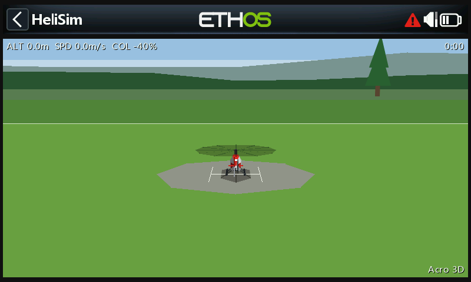
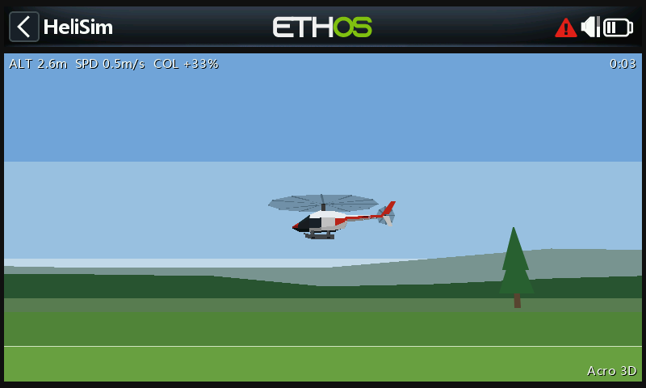
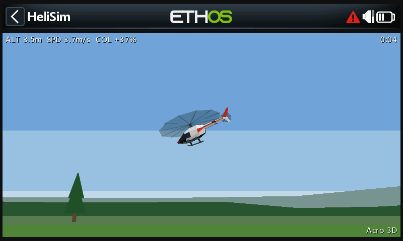
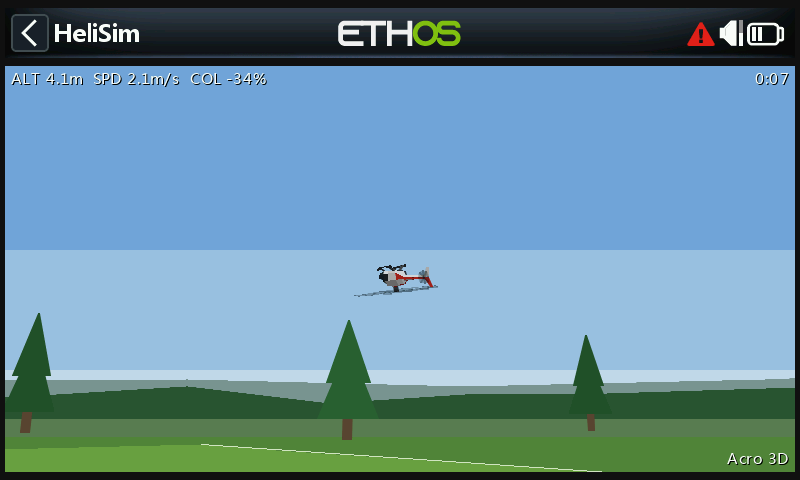

# HeliSim

A 3D RC helicopter flight simulator for FrSky Ethos radios, flown with the radio's own sticks.

| On the pad | Hover, side on |
| --- | --- |
|  |  |
| **Forward flight** | **Inverted hover** |
|  |  |

*Screenshots from the Ethos simulator (X20S).*

You stand at the edge of a flying field and the view turns to follow the helicopter, as when flying a real one. The model is a low-poly Bell 206 style scale fuselage (the same shape as the Rotorflight Configurator's, cut down from rotorflight-lua-ethos-suite `lib/heli3d.lua`). It has a translucent rotor disc that tilts with the cyclic, a ground shadow, and a dark belly, so upright and inverted are easy to tell apart.

## Flying

HeliSim runs on the whole screen, without the title bar. The flight data, flight mode and flight time sit on a black bar at the top.

- Lower the throttle stick to start. The rotor spools up over the spool-up time (3 seconds by default).
- **Acro** (default): the sticks set roll, pitch and yaw rates, as with a flybarless helicopter.
- **Self-level**: the cyclic sets the tilt, and centre stick levels the helicopter (it also rolls out of inverted).
- **3D collective** (default): centre stick is zero pitch and low stick is full negative, for inverted flight. **Normal**: low stick is slightly negative and the hover is just below centre. There is no expo on collective; full collective gives 3 g, so the 3D hover is at about +33%.
- Landing too hard, sliding, tipping over, or hitting the ground with a blade or the tail is a crash.

| Key | Action |
| --- | --- |
| Enter | Back to the pad |
| Page | Settings |
| Rotary | Zoom |
| Exit | Close the tool |

Settings (saved to `helisim.cfg` next to the script):

| Setting | Default | Range |
| --- | --- | --- |
| Flight mode | Acro | Acro, Self-level |
| Collective | 3D | 3D, Normal |
| Cyclic rate | 450 deg/s | 50–1200 |
| Yaw rate | 600 deg/s | 50–1500 |
| Expo | 30% | 0–90% |
| Head response | Crisp | Soft, Normal, Crisp, Locked in (how fast the rates follow the sticks) |
| Spool-up time | 3 s | 1–20 s |
| Rotor direction | Clockwise | Clockwise, Counter-clockwise |
| Auto zoom | On | |
| Detail | Low | Low, High (see Performance) |
| Show CPU stats | Off | |

Stick sources are the analog sticks by function (`CATEGORY_ANALOG` members 0–3: rudder, elevator, throttle, aileron), so the stick mode does not matter.

## Layout

- `src/helisim/main.lua`: registers the system tool
- `src/helisim/sim.lua`: app state, sticks, settings, HUD
- `src/helisim/lib/physics.lua`: flight model (rate-stabilised rotor head, thrust, drag, ground effect, contact)
- `src/helisim/lib/heli.lua`: the helicopter mesh (about 110 faces, built in stages)
- `src/helisim/lib/render.lua`: camera, scenery, projection, display lists
- `tools/headless.py`: runs the sim headless with scripted sticks, counts Lua instructions per callback, saves frames as PNG
- `tools/make_icon.py`: draws `gfx/icon.png` from the mesh

## Performance

Ethos aborts a `paint` that runs about 20000 Lua instructions ("Max instructions count reached"). This was measured in the Ethos simulator, where `wakeup` was not held to the same budget. So `wakeup` does all the work (physics, camera, scenery, projection, culling, shading, sorting) into flat display lists, and `paint` only replays them, using about 25% of its budget. No tables are allocated per frame. Faces are sorted with a plain numeric `table.sort` (depth and face index packed into one number), so sorting runs no Lua comparator.

When the helicopter is small on screen it is drawn without the mast, tail rotor and skids, and beyond 25 m one scale serves the whole model. When nothing has moved (sitting on the pad) the frame is not rebuilt or repainted. A new frame invalidates rectangles only: a plain `lcd.invalidate()` makes Ethos clear the window first, which cost 1 fps at High detail and 2-3 fps at Low on an X20. The HUD text sits on opaque bars outside the scene, so it is drawn without a shadow and only every other frame; in between only the scene's rectangle is invalidated and Ethos keeps the bars.

On a radio both the Lua work and the `lcd` fills cost frame time, and the **Detail** setting trades scenery for speed:

- **Low** (default): the hills and tree line are flat bands, there is no mown strip around the pad, the shadow is two triangles, the rotor disc has 8 segments and the low detail model is used until the helicopter is close.
- **High**: hill and tree line silhouettes, the mown strip, a 12-segment rotor disc and the full model from about 16 m.

Turn on **Show CPU stats** to see, on a second bar at the bottom, per second, the paints (fps) and wakeups, the mean time of a wakeup and of a paint, and the paint's instruction budget; below that triangle and face counts, memory and stick values.

## VS Code deploy

The same workflow as rotorflight-lua-ethos-suite:

- `Deploy & Launch [SIM]`
- `Deploy Radio`, `Deploy Radio [Fast]`
- `Deploy Radio + Serial Debug`

The simulator target comes from the Ethos extension settings in `.vscode/settings.json` (`ethos.board`, `ethos.protocol`, `ethos.release`, `ethos.simulatorsFolder`). The scripts go to `simulators/<BOARD>_<PROTOCOL>@<release>/scripts/helisim`.

## Headless testing

```text
pip install lupa pillow
python tools/headless.py --scenario hover --frames 100,200
python tools/headless.py --scenario circuit --level --seconds 20 --frames 150,300
```

The script prints position, attitude and instruction counts, and writes frames to `tools/out/`. Its instruction counts include the Lua stand-ins for `lcd` calls, so its paint figures are higher than on a radio.

The Ethos WASM simulator from [ethos-tools](https://github.com/FrSkyRC/ethos-tools) (`simulation/run_wasm.js --serve`) can run the real firmware headless. Its analog inputs 0–3 are rudder, throttle, elevator and aileron, in percent.
